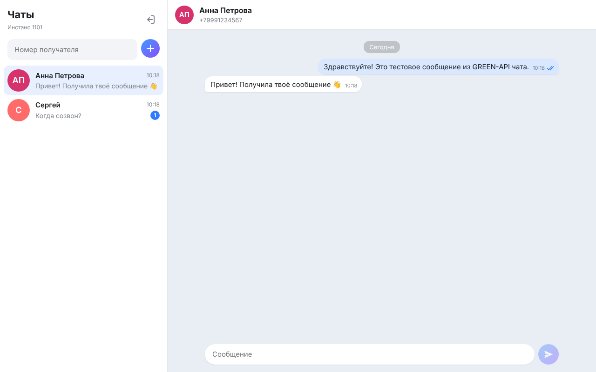
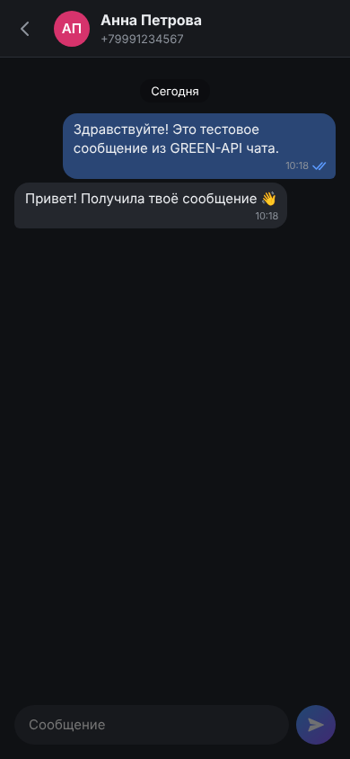

# GREEN-API Chat

Тестовое задание на должность «Фронтенд разработчик React» в [GREEN-API](https://green-api.com).

Минималистичный веб-чат в стиле [web.max.ru](https://web.max.ru) для отправки и получения текстовых сообщений в MAX через GREEN-API. Работает и с инстансами WhatsApp: методы API и формат `chatId` у них одинаковые.

**Демо:** https://arsenii-gusev.github.io/green-api-test/

| Десктоп | Телефон (тёмная тема) |
| --- | --- |
|  |  |

## Возможности

- Вход по `idInstance` и `apiTokenInstance` с проверкой состояния инстанса (`getStateInstance`).
- Создание чата по номеру телефона получателя.
- Отправка текстовых сообщений методом [`SendMessage`](https://green-api.com/v3/docs/api/sending/SendMessage/).
- Получение входящих сообщений по технологии [HTTP API](https://green-api.com/v3/docs/api/receiving/technology-http-api/): `ReceiveNotification` + `DeleteNotification`.
- Статусы исходящих: отправляется, отправлено, доставлено, прочитано, ошибка.
- Сообщения, отправленные с телефона, тоже появляются в чате; новые собеседники добавляются в список автоматически.
- История чатов сохраняется в `localStorage` отдельно для каждого инстанса.
- Адаптивная вёрстка и тёмная тема по настройкам системы.

## Запуск локально

Нужен Node.js 20.19+ или 22.12+.

```bash
git clone https://github.com/arsenii-gusev/green-api-test.git
cd green-api-test
npm install
npm run dev
```

Откройте http://localhost:5173.

Другие команды:

```bash
npm test          # юнит-тесты (Vitest)
npm run lint      # линтер (oxlint)
npm run build     # production-сборка в dist/
npm run preview   # просмотр собранной версии
```

## Подготовка инстанса GREEN-API

1. Зарегистрируйтесь в [личном кабинете](https://console.green-api.com) и создайте инстанс MAX (или WhatsApp).
2. Авторизуйте инстанс, отсканировав QR-код в приложении мессенджера.
3. Скопируйте `idInstance`, `apiTokenInstance` и `apiUrl` со страницы инстанса.
4. В настройках инстанса оставьте поле URL вебхука **пустым**: иначе уведомления уходят на вебхук и не попадают в очередь `ReceiveNotification`. Включите получение уведомлений о входящих сообщениях и статусах исходящих.

## Как пользоваться

1. Введите `idInstance`, `apiTokenInstance` и, если он отличается от `https://api.green-api.com`, `apiUrl`.
2. Введите номер получателя в международном формате (например, `79991234567`) и нажмите «+».
3. Напишите сообщение и нажмите Enter (Shift+Enter переносит строку).
4. Когда получатель ответит в мессенджере, ответ появится в чате.

## Как устроено

```
src/
├── api/greenApi.ts                  # запросы к GREEN-API и тексты ошибок
├── hooks/useNotificationPolling.ts  # цикл ReceiveNotification → обработка → DeleteNotification
├── lib/
│   ├── chats.ts           # reducer состояния чатов (чистые функции, покрыт тестами)
│   ├── notifications.ts   # разбор уведомлений GREEN-API в события чата
│   ├── phone.ts           # нормализация номера и chatId
│   ├── storage.ts         # localStorage
│   └── time.ts            # форматирование дат
└── components/            # LoginScreen, Messenger, Sidebar, ChatView, Avatar, Icons
```

- Бэкенда нет: браузер обращается к GREEN-API напрямую.
- Получение сообщений: длинный опрос `receiveNotification?receiveTimeout=5`. Каждое уведомление сначала обрабатывается, затем удаляется из очереди через `deleteNotification`. Уведомление, пришедшее повторно, не создаёт дубликат, потому что сообщения сравниваются по `idMessage`.
- Отправленное сообщение сразу появляется в чате со статусом «отправляется». После ответа `sendMessage` оно получает настоящий `idMessage`, а уведомления `outgoingMessageStatus` обновляют галочки.
- Если GREEN-API присылает для собеседника `chatId` в другом формате, чем номер телефона, чат запоминает его как синоним. Синоним определяется по уведомлению об отправке нашего же сообщения, поэтому ответы попадают в тот же диалог.

Стек: React 19, TypeScript, Vite, Vitest, oxlint. Деплой выполняется GitHub Actions на GitHub Pages при пуше в `main`.
